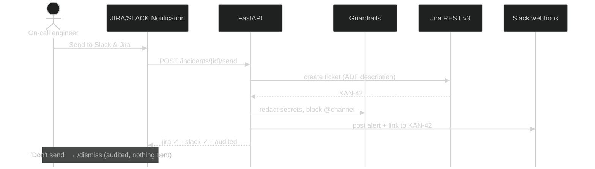

<div class="tag">C10 · G4 Hackathon</div>

# Multi-Agent DevOps<br/>Incident Analysis Suite

From raw logs to a reviewed incident plan, a Jira ticket and a Slack alert in about 15 seconds.

<div class="mt-10 flex gap-2">
  <span class="tag">LangGraph</span><span class="tag">FastAPI</span><span class="tag">OpenRouter</span>
  <span class="tag">ChromaDB</span><span class="tag">Slack</span><span class="tag">Jira</span>
</div>

<!--
Hi everyone, we're group G4. In the next ten minutes we'll show how a team of AI agents turns a messy
log file into incidents, fixes, a checklist, and — only after a human says yes — a Jira ticket and a Slack alert.
-->

---
layout: two-cols-header
---

# The problem

On-call engineers lose the first 30 minutes of every incident to manual triage.

::left::

<div class="card mr-4">
<h3>🔎 Needle in a haystack</h3>
<p>Thousands of log lines across services; the root cause hides in a handful.</p>
</div>

<div class="card mr-4 mt-4">
<h3>📚 Tribal knowledge</h3>
<p>Runbooks exist, but nobody finds the right one at 3 a.m.</p>
</div>

::right::

<div class="card">
<h3>✍️ Repetitive paperwork</h3>
<p>Writing the Slack update and Jira ticket by hand while the system is down.</p>
</div>

<div class="card mt-4">
<h3>⚠️ Automation risk</h3>
<p>Fully automatic bots spam channels, leak secrets and file duplicate tickets.</p>
</div>

<!--
Four pains: finding the signal, finding the right runbook, writing the same updates every time,
and the fear that automation will make things worse. Our design answers each one — especially the last:
nothing leaves the system without a human click.
-->

---

# Solution overview

Upload a log → six specialised agents analyse it → a human approves what gets sent.

<div class="grid grid-cols-3 gap-4 mt-8">
  <div class="card"><h3>1 · Understand</h3><p>Parse <code>.log / .json / .csv</code>, redact secrets, strip prompt-injection lines, group events into incidents with severity and evidence.</p></div>
  <div class="card"><h3>2 · Recommend</h3><p>Retrieve matching runbooks (RAG) and produce grounded fix plans, a rollback plan and one ordered checklist.</p></div>
  <div class="card"><h3>3 · Notify safely</h3><p>Draft Slack alerts and Jira tickets. <b>Send</b> or <b>Don't send</b> per critical issue — every decision audited.</p></div>
</div>

<div class="grid grid-cols-4 gap-4 mt-10 text-center">
  <div><div class="metric">~15 s</div><div class="metric-label">per analysis (was 34.5 s)</div></div>
  <div><div class="metric">$0.06</div><div class="metric-label">LLM cost per run</div></div>
  <div><div class="metric">0.96</div><div class="metric-label">category recall (evals)</div></div>
  <div><div class="metric">100%</div><div class="metric-label">evidence grounding</div></div>
</div>

<!--
Three stages: understand, recommend, notify safely. The numbers at the bottom come from our eval suite
on labelled logs — not from a demo run we picked.
-->

---

# Multi-agent architecture

<div class="arch">
  <div class="row">
    <div class="node ui">Dashboard UI<small>frontend/ · vanilla JS</small></div><span class="arr">⇄</span>
    <div class="node">FastAPI<small>api/ · REST + background task</small></div><span class="arr">⇄</span>
    <div class="node store">SQLite<small>results · audit trail</small></div>
  </div>
  <div class="down">↓ starts</div>
  <div class="lg">
    <div class="lgt">LangGraph analysis graph</div>
    <div class="row">
      <div class="node ag">Log Reader</div><span class="arr">→</span>
      <div class="node ag">Classifier</div><span class="arr">→</span>
      <div class="node ag">Remediation</div><span class="arr">⇉</span>
      <div class="stack"><div class="node ag">Cookbook</div><div class="node ag">Slack drafter</div><div class="node ag">Jira drafter</div></div><span class="arr">⇉</span>
      <div class="node gr">Guardrails</div><span class="arr">→</span>
      <div class="node wait">Awaiting approval</div>
    </div>
  </div>
  <div class="row bottom">
    <div class="node ext">OpenRouter LLMs<small>gpt-4o-mini · gpt-4o · JSON mode</small></div>
    <div class="node store">ChromaDB<small>runbook RAG</small></div>
    <span class="grow"></span>
    <div class="node human">👤 Send</div><span class="arr">→</span>
    <div class="node ext">Jira REST v3</div><span class="arr">→</span>
    <div class="node ext">Slack webhook</div>
  </div>
</div>

<!--
The UI only talks to FastAPI, so secrets never reach the browser. FastAPI starts the LangGraph workflow
as a background task. Three drafters run in parallel after remediation, then guardrails check everything,
and the run stops at "awaiting approval". Slack and Jira are only reached from the human Send action.
-->

---

# Agent responsibilities

| Agent | Input → Output | Model | Fallback if the LLM fails |
|---|---|---|---|
| **Log Reader** | raw file → parsed, redacted events | none (deterministic) | n/a |
| **Classifier** | events → incidents + severity + evidence IDs | `gpt-4o-mini` | one incident per failing service |
| **Remediation** | incident + retrieved runbooks → fix plan, rollback, risk | `gpt-4o` | steps from best-matching runbook |
| **Cookbook** | all plans → one ordered checklist | `gpt-4o` | merged, de-duplicated actions |
| **Slack drafter** | incidents → Slack mrkdwn alert | `gpt-4o-mini` | message template |
| **Jira drafter** | ERROR/CRITICAL incidents → ticket drafts | `gpt-4o` | ticket template |
| **Guardrails** | all drafts → findings, flagged actions | none (deterministic) | n/a |

<div class="mt-4 text-sm opacity-80">Every agent records latency, tokens and exact cost per call — visible in <b>Agent Activity</b>.</div>

<!--
Each agent has one job and one backup plan. If OpenRouter is down, the pipeline still finishes with
rule-based output — degraded, but never empty. Two agents use no LLM at all, on purpose.
-->

---
class: code-sm
---

# LangGraph workflow

<div class="grid grid-cols-5 gap-5">
<div class="col-span-3">

<div>

```python
# orchestration/graph.py
def build_analysis_graph():
    graph = StateGraph(AnalysisState)
    graph.add_node("parse_logs", traced("Log Reader")(parse_logs))
    graph.add_node("classify_incidents", traced("Classifier")(...))
    graph.add_node("generate_remediation", traced("Remediation")(...))
    for name in DRAFTERS:               # cookbook, slack, jira
        graph.add_node(name, traced(...)(...))
    graph.add_node("apply_guardrails", traced("Guardrails")(...))

    # early exit when there is nothing to analyse
    graph.add_conditional_edges("parse_logs", _after_parse,
                                ["classify_incidents", END])
    graph.add_conditional_edges("classify_incidents", _after_classify,
                                ["generate_remediation", END])
    for name in DRAFTERS:                                   # fan out
        graph.add_edge("generate_remediation", name)
    graph.add_edge(DRAFTERS, "apply_guardrails")            # fan in
    graph.add_edge("apply_guardrails", "await_approval")
    return graph.compile()
```

</div>

</div>
<div class="col-span-2">

```python
class AnalysisState(AnalysisResult):
    # parallel agents append,
    # never overwrite each other
    agent_runs: Annotated[
        list[AgentRun], operator.add]
    guardrail_findings: Annotated[
        list[GuardrailFinding], operator.add]
```

<div class="card mt-4">
<h3>Why it matters</h3>
<ul>
<li>Early exit when a log has no incidents</li>
<li>Parallel drafters: <b>34.5 s → 15.5 s</b></li>
<li>Typed Pydantic state, validated at every hop</li>
<li><code>@traced</code> captures latency, tokens, cost</li>
</ul>
</div>

</div>
</div>

<!--
Walk top to bottom: the nodes, the conditional edges that end early, the fan-out to three drafters,
and the fan-in. The reducer on the right is what makes parallel agents safe: each appends its trace
instead of overwriting the list.
-->

---
layout: two-cols
---

# UI walkthrough · 1

**New Analysis** — upload, then *Start Analysis* sits right under the drop zone.

While agents work, one LLM-style status line shows what's happening now; finished steps tick off below.


::right::


<div class="ml-4 mt-3 text-sm opacity-80">
<b>Dashboard</b> — compact KPI row, recent analyses with pagination and filters, and the open critical/high issues that need attention.
</div>

<!--
Left: the progress view — "Searching runbooks for fixes…" with completed steps underneath, no busy diagram.
Right: the dashboard everyone lands on.
-->

---
layout: two-cols
---

# UI walkthrough · 2

**Detected Issues** — severity tiles, filters, and per-issue evidence.


::right::


<div class="ml-4 mt-3 text-sm opacity-80">
<b>Issue drawer</b> — Summary · Log Evidence · Remediation (runbooks cited, risky steps flagged ⚠️) · Checklist · Slack &amp; Jira.
</div>

<!--
Every incident links back to the exact log lines that support it. In the remediation tab, any
destructive step — DROP TABLE, rm -rf, kubectl delete namespace — is flagged "review first".
-->

---

# Example incident scenario

<div class="grid grid-cols-2 gap-6">
<div>

```log
# sample_logs/order_processing_incident.csv
12:01:02 ERROR    order-api  Insert failed: deadlock
12:01:03 WARNING  order-db   Long-running txn (45 s)
12:01:04 ERROR    order-api  HTTP 500 returned
12:01:05 CRITICAL order-api  Queue depth > 10000
12:01:08 ERROR    order-api  rabbitmq:5672 refused
12:01:10 ERROR    shipping   Shipping API 504
```

<div class="card mt-4">
<h3>Agent output · 14 s · $0.06</h3>
<ul>
<li><b>7 incidents</b>, 1 critical: <i>Order Processing Queue Depth Exceeded</i></li>
<li>Runbooks matched: queue backlog, database deadlock, third-party dependency</li>
<li>Checklist: 29 ordered steps (Do now / Investigate / Prevent)</li>
</ul>
</div>

</div>
<div>

```json
{
  "title": "Order Processing Queue Depth Exceeded",
  "severity": "CRITICAL",
  "category": "PERFORMANCE",
  "affected_services": ["order-api"],
  "evidence_event_ids": ["evt-0009", "evt-0010"],
  "confidence": 0.9
}
```

<div class="text-sm opacity-80 mt-3">Evidence IDs must exist in the log — anything the model invents is dropped (grounding = 1.0 in evals).</div>

</div>
</div>

<!--
This is the real sample from the repo. One critical incident, six supporting ones, every claim tied to
an event ID. If the model cites a line that doesn't exist, the incident is discarded.
-->

---

# Slack & Jira integration flow

<div class="seq">



</div>

<div class="grid grid-cols-3 gap-4 mt-1 text-sm benefits">
  <div class="card"><h3>Simulation ↔ Live</h3><p>Switch per integration in Settings. Default: Simulation.</p></div>
  <div class="card"><h3>Idempotent retry</h3><p>Reuses the ticket, never double-posts to Slack.</p></div>
  <div class="card"><h3>Secrets server-side</h3><p>Webhook and token never reach the browser.</p></div>
</div>

<!--
One click does both, in a deliberate order: Jira first, so the Slack alert can link to the ticket.
If Jira succeeds and Slack fails, a retry won't create a second ticket. "Don't send" is also an
audited decision — that's the human-in-the-loop requirement.
-->

---

# Business benefits

<div class="grid grid-cols-2 gap-3 mt-2 benefits">
  <div class="card"><h3>⏱ Faster MTTR</h3><p>Triage drops from ~30 minutes of reading logs to ~15 seconds of analysis plus a review.</p></div>
  <div class="card"><h3>🧠 Runbooks actually used</h3><p>RAG puts the team's own documented fix in front of the engineer, with citations.</p></div>
  <div class="card"><h3>🛡 Safe automation</h3><p>Human approval, secret redaction, injection screening and destructive-step flags — all audited.</p></div>
  <div class="card"><h3>💸 Predictable cost</h3><p>~$0.06 per analysis; cheap model for classification, stronger model only where reasoning matters.</p></div>
  <div class="card"><h3>📈 Measurable quality</h3><p>Eval suite gates releases: recall, grounding, severity accuracy, latency and cost budgets.</p></div>
  <div class="card"><h3>🔁 Consistent comms</h3><p>Every Slack alert and Jira ticket follows the same structure: cause, impact, actions, rollback.</p></div>
</div>

<!--
The headline is MTTR, but the quieter win is consistency: every incident gets the same quality of
write-up no matter who is on call or what time it is.
-->

---

# Technology stack

<div class="grid grid-cols-3 gap-5 mt-6">
<div class="card">
<h3>Orchestration &amp; AI</h3>
<p><span class="tag">LangGraph</span><span class="tag">OpenRouter</span><span class="tag">gpt-4o</span><span class="tag">gpt-4o-mini</span><span class="tag">JSON mode</span><span class="tag">Pydantic</span></p>
</div>
<div class="card">
<h3>Retrieval &amp; data</h3>
<p><span class="tag">ChromaDB</span><span class="tag">all-MiniLM-L6-v2</span><span class="tag">SQLite (WAL)</span></p>
</div>
<div class="card">
<h3>Backend</h3>
<p><span class="tag">FastAPI</span><span class="tag">BackgroundTasks</span><span class="tag">pydantic-settings</span><span class="tag">rate limit</span><span class="tag">API key</span></p>
</div>
<div class="card">
<h3>Frontend</h3>
<p><span class="tag">Vanilla JS SPA</span><span class="tag">SVG charts</span><span class="tag">Streamlit (alt UI)</span></p>
</div>
<div class="card">
<h3>Integrations</h3>
<p><span class="tag">Slack webhook</span><span class="tag">Jira REST v3 + ADF</span></p>
</div>
<div class="card">
<h3>Quality &amp; ops</h3>
<p><span class="tag">pytest · 43 tests</span><span class="tag">LLM-judge evals</span><span class="tag">Docker</span><span class="tag">JSON logs</span><span class="tag">/health /ready</span></p>
</div>
</div>

```bash
make install && make env      # venv + .env from .env.example
make api                      # http://localhost:8000/ui/
make test && make eval        # 43 tests · eval gate
```

<!--
Deliberately boring infrastructure — SQLite and in-process tasks — so the interesting part is the
agents. Everything runs locally with three make commands.
-->

---

# Next steps

<div class="grid grid-cols-2 gap-6 mt-6">
<div>

### Scale
- Postgres + task queue (Celery / Arq) + Redis rate limits
- Streaming log ingestion (CloudWatch, Loki, Kafka)
- SSO and real approver identity in the audit trail

### Smarter agents
- More runbooks: deadlocks, brokers, auth, third-party APIs
- Feedback loop: misclassified incidents become eval cases
- Correlate with deploys and metrics, not only logs

</div>
<div>

### Integrations
- Slack interactive buttons (approve from Slack)
- Jira assignee mapping and status sync
- PagerDuty / Opsgenie escalation for criticals

<div class="card mt-6">
<h3>Try it</h3>
<p><code>github.com/MdFasikhan/C10_G4_Hackathon</code></p>
</div>

</div>
</div>

<!--
The architecture already separates agents from delivery, so each of these is an additive change.
Our first priority would be the feedback loop: every human "Don't send" or edited ticket is a new
labelled example for the evals.
-->

---
layout: center
class: text-center
---

# Thank you

Questions?

<div class="mt-6 opacity-70 text-sm">C10 · G4 — Multi-Agent DevOps Incident Analysis Suite</div>

<div class="mt-8 flex gap-3 justify-center">
  <a class="tag" href="./c10-g4-incident-suite.pdf" target="_blank">⬇ Download PDF</a>
  <a class="tag" href="./c10-g4-incident-suite.pptx" target="_blank">⬇ Download PPTX</a>
  <a class="tag" href="https://github.com/MdFasikhan/C10_G4_Hackathon" target="_blank">GitHub repo</a>
</div>

<!--
Thanks — happy to run a live analysis on any log file you have.
-->
